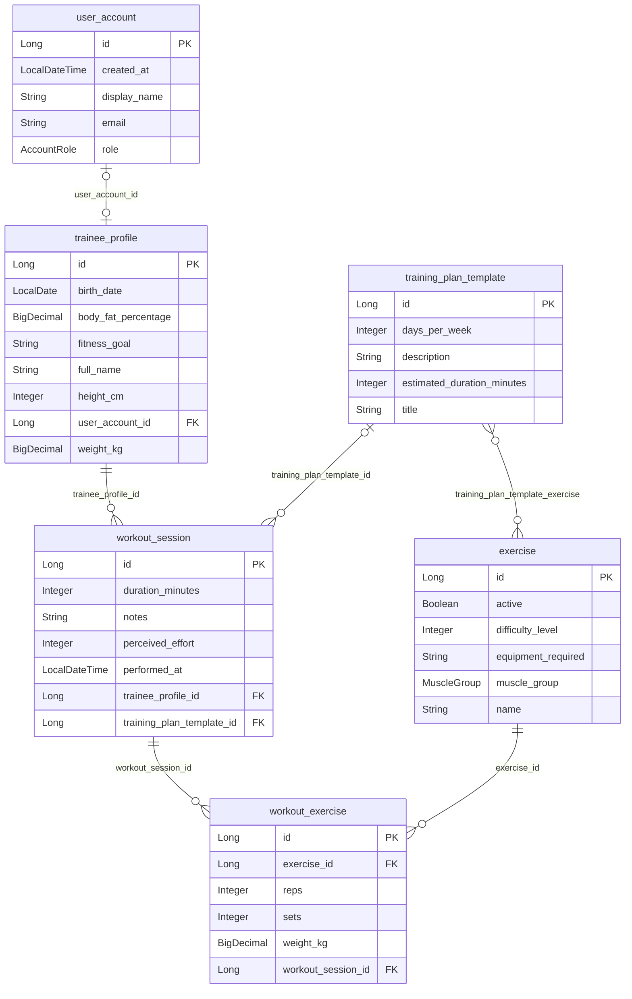

# Schemat bazy danych

Plik generują reguły projektu (panel Maven → Lifecycle → verify). Nie edytujcie go ręcznie.

Tabele: 7 (w tym tabele łączące @ManyToMany: training_plan_template_exercise) · kolumny: 37 · relacje: 4 × @ManyToOne, 2 × @OneToMany, 1 × @OneToOne, 1 × @ManyToMany

| Tabela | Encja | Kolumny | Klucze obce |
|---|---|---|---|
| exercise | Exercise | 6 | — |
| trainee_profile | TraineeProfile | 8 | user_account_id |
| training_plan_template | TrainingPlanTemplate | 5 | — |
| user_account | UserAccount | 5 | — |
| workout_exercise | WorkoutExercise | 6 | exercise_id, workout_session_id |
| workout_session | WorkoutSession | 7 | trainee_profile_id, training_plan_template_id |

